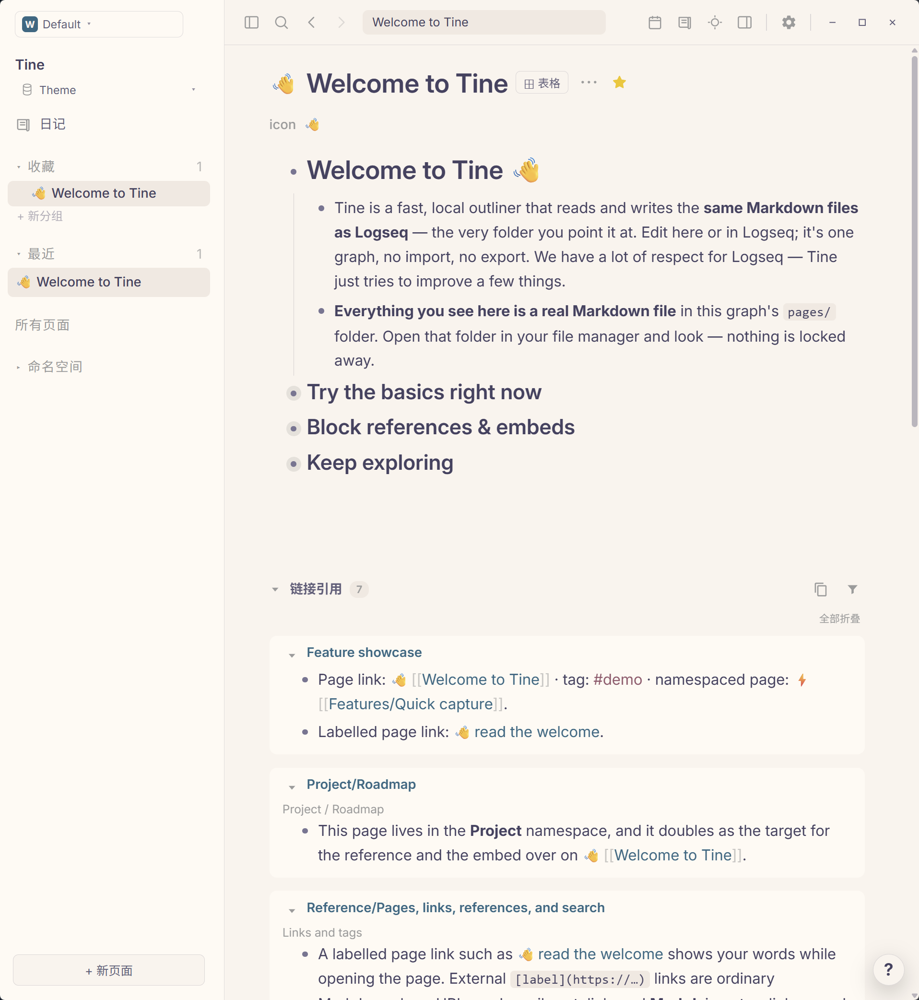

# Rosé Pine · Prism

**玫瑰安睡在黎明，松影收起夜色。愿纸页之间，留一寸静谧。**

[English](README.md) · [下载 theme.json](https://github.com/EllisMorrow/tine-theme-rose-pine-prism/releases/latest/download/theme.json)

Rosé Pine Dawn 与 Moon 相映于同一款 Prism 主题：日间是暖奶油纸色，夜晚转为柔和的蓝紫暮色，点缀玫瑰、松绿与鸢尾。

在 [Prism 主题画廊](https://github.com/martinkoutecky/tine/discussions/786)中，可以直观比较全部 29 个主题的浅色与深色效果。

### 深色模式

### 浅色模式

*用户测试后提供的 Windows 实机截图，两套配色均实际包含在同一个主题包中。*

## 安装

1. 下载 [theme.json](https://github.com/EllisMorrow/tine-theme-rose-pine-prism/releases/latest/download/theme.json)。
2. 在 Tine 打开 **设置 → 外观 → 主题包 → 选择 theme.json**，选择下载的文件。
3. 点击 **使用颜色**，选择 **浅色、深色或跟随系统**。

需要主题 API **0.2** 支持。原有 `logseq/custom.css` 和设备强调色可能影响效果；主题只负责 API 支持的颜色，不包含额外字体、布局或任务标记样式。

## 配色

| 角色 | 浅色 | 深色 |
| --- | --- | --- |
| 主背景 | `#FAF4ED` | `#232136` |
| 侧栏 | `#FFFaf3` | `#1e1c2e` |
| 正文 | `#464261` | `#E0DEF4` |
| 标题 | `#464261` | `#E0DEF4` |
| 强调色 | `#907AA9` | `#C4A7E7` |
| 链接 | `#286983` | `#9CCFD8` |
| 标签 | `#98566B` | `#ea9a97` |
| 高亮底色 | `#F5E7C9` | `#393552` |

## 验证情况

通过官方主题格式检查；浏览器样例检查了两套完整变量、模式切换及指定颜色组合。用户提供了上方 Windows 明暗实机截图，展示公开欢迎页面上的标题、正文、层级、链接、标签、行内代码和引用区域。高亮、选中操作、设置状态和其它平台未由这些截图覆盖，不据此宣称全部路径均已验证。

## 来源与边界

基于 [Rosé Pine Dawn / Rosé Pine Moon](https://github.com/rose-pine/rose-pine-palette)，固定版本 `92af52b465ab6e47437aca223c9b8d3009a2023b`，采用 MIT 许可并保留 [原始声明](LICENSE)。Dawn 与 Moon 均为上游官方 Rosé Pine 变体，也对应 Codex 主题系列的浅深搭配。Tine 角色为独立映射；浅色文字和标签的可读性调整已逐项记录。

独立社区适配由 EllisMorrow 完成，使用 AI 辅助开发。不分发 Codex 程序代码、标志或附带资源，不代表相关项目或 OpenAI 的官方产品，也不承诺与 Codex 像素级一致。具体映射和验证边界见 [适配说明](docs/adaptation.md)。

顶部徽标统计 GitHub Release 附件累计下载量，不代表安装人数。可在本仓库反馈问题，附版本、系统、模式及不包含私人内容的截图。
